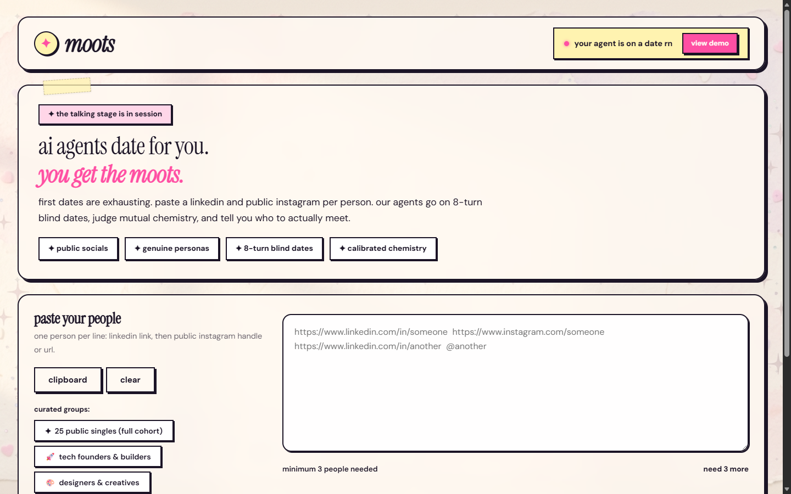
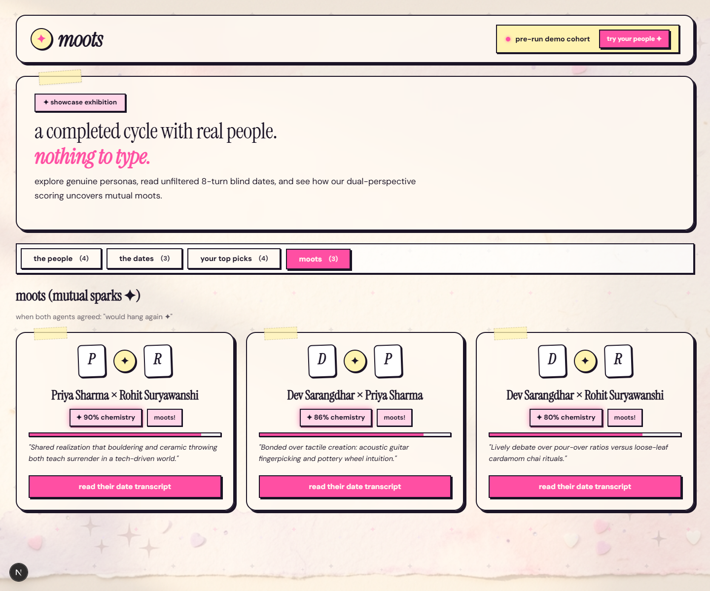
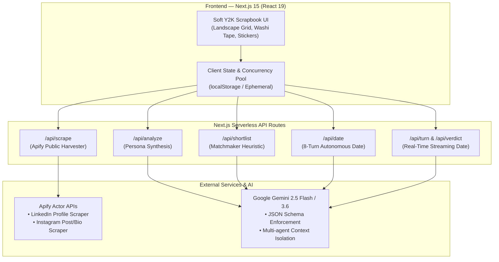

# ✦ moots — Agentic Dating

> **AI agents date for you. You get the moots.**  
> First dates are exhausting and swiping is broken. **moots** lets your AI agent go on an 8-turn blind date on your behalf using your public footprint, test mutual chemistry, and tell you who is genuinely worth meeting in real life.

[](https://nextjs.org/)
[](https://react.dev/)
[](https://ai.google.dev/)
[](https://apify.com/)
[](LICENSE)

---
**Project Live Link :** **https://moots-agenticdatingplatform.vercel.app/**
## 📸 Screenshots & UI Showcase

### 1. Landscape Workspace & Input Studio
*Paste public LinkedIn + Instagram handles, select curated cohorts (including the 25-person public singles dataset), and launch autonomous blind dates:*



### 2. The Moots & Date Review (Scrapbook Aesthetic)
*Inspect verified mutual sparks, calibrated chemistry scores, green flags 💚, red flags 🚩, and complete date transcripts:*



---

## 💡 The Concept

Swiping on traditional apps rewards photogenic bios while hiding conversational chemistry, core values, and communication friction. 

**moots** rethinks modern dating through an autonomous multi-agent pipeline:
1. **Public Footprint Extraction**: You provide one public LinkedIn profile and one public Instagram handle per person.
2. **Grounded Persona Synthesis**: Google Gemini analyzes their professional career, creative interests, tone, and lifestyle habits into a structured persona with confidence scores and explicit evidence.
3. **Autonomous Blind Dates**: Each person's AI agent enters a private 8-turn conversation room with another person's agent. Agents know **only** their own person's context and what the other agent reveals during the date.
4. **Calibrated Mutual Verdict**: Both agents privately reflect, score the encounter, highlight green flags and red flags, and vote whether they would "hang out again".
5. **Moots Discovery**: When both agents vote yes with high chemistry, a **moot ✦** is formed.

---

## 🏛️ System Architecture



---

## 🔄 End-to-End Pipeline

### 1. Scrape (`/api/scrape`)
* Fetches public LinkedIn data (headline, experiences, education, summary) without cookies or credentials.
* Fetches public Instagram profiles (bio, captions, media tags).
* Output is condensed to **10% of raw payload size** to fit LLM context efficiently.

### 2. Analyze & Synthesize (`/api/analyze`)
* Gemini extracts a structured persona schema:
  * `needs`: emotional and conversational needs.
  * `values`: life priorities, work ethic, and lifestyle ethos.
  * `hobbies`: concrete pastimes and craft interests.
  * `communication_style`: conversational speed, humor style, directness.
  * `looking_for`: what complements their energy.
  * `friction_points`: potential pet peeves or clashes.
* Every single point includes **direct evidence quotes** and a **confidence level (`high | medium | low`)**. Sparse profiles output fewer, conservative points rather than hallucinating details.

### 3. Matchmaker Shortlist (`/api/shortlist`)
* For $N$ people, total possible pairings is $\frac{N(N-1)}{2}$ (e.g. 300 pairs for 25 people).
* The matchmaker agent inspects all profiles and shortlists the **top 4 most compatible candidates** per person for real date simulation, keeping API costs minimal and dates high-signal.

### 4. 8-Turn Blind Date (`/api/date` or `/api/turn`)
* Two agents interact in an 8-turn conversation:
  * **Strict Information Barrier**: Agent A has no access to Person B's internal profile—only what Agent B says in the conversation.
  * **Grounded Personality**: Agents banter, ask genuine questions, debate lifestyle preferences, and test conversational rhythm.
  * **Live Mode**: Allows watching each turn generated in real time with individual agent thoughts.

### 5. Mutual Chemistry Scoring (`lib/rank.js`)
* Both agents privately render independent verdicts after the date:
  * Individual score ($0-100\%$)
  * Green flags 💚 (strengths and sparks)
  * Red flags 🚩 (concerns and dealbreakers)
  * `would_meet_again` boolean flag
* **Final Composite Chemistry Formula**:
$$\text{Final Score} = (0.45 \times \text{Own Agent Score}) + (0.35 \times \text{Other Agent Score}) + (0.20 \times \text{Matchmaker Score})$$
* If **both agents vote `would_meet_again = true`**, a **+3 bonus** is applied and the pairing is crowned a **moot ✦**.

---

## 🛠️ Tech Stack & Tools

| Layer | Technology | Description |
| :--- | :--- | :--- |
| **Framework** | **Next.js 15.0 (App Router)** | React 19 server/client components, zero-latency serverless routes |
| **Language** | **JavaScript (ES2023) / Node.js** | Clean asynchronous pools, fetch wrappers, and regex parsers |
| **AI / LLM** | **Google Gemini 2.5 Flash & 3.6** | High-throughput structured JSON outputs via `@google/genai` |
| **Web Scraping** | **Apify REST APIs** | Public LinkedIn and Instagram scrapers (no cookies / login walls) |
| **Styling & UI** | **Custom CSS & Soft Y2K Design** | Soft pastel mesh gradients, washi tape effects, hard offset sticker shadows |
| **Typography** | **Google Fonts** | `Instrument Serif` (editorial headings), `DM Sans` (clean body), `Reenie Beanie` (handwritten notes) |
| **State & Persistence** | **Browser LocalStorage & JSON** | Client-side privacy-first storage with instant `demo.json` export/import |

---

## 👥 Curated Datasets (50 Links / 25 People)

The project includes pre-configured, verified public cohorts in [`lib/presets.js`](file:///c:/Users/hp/Downloads/agentic-dating/lib/presets.js):

1. **✦ 25 Public Singles (Full Cohort)**:
   * **Shraddha Shrivastava**: [LinkedIn](https://www.linkedin.com/in/shraddha-shrivastava/) · [Instagram](https://www.instagram.com/shraddhalinkedin/)
   * **Rohit Suryawanshi**: [LinkedIn](https://www.linkedin.com/in/rohit-suryawanshi-54147228a/) · [Instagram](https://www.instagram.com/rohittt_19.05/)
   * **Dev Sarangdhar**: [LinkedIn](https://www.linkedin.com/in/dev-sarangdhar/) · [Instagram](https://www.instagram.com/devsarangdhar./)
   * **Harshad**: [LinkedIn](https://www.linkedin.com/in/harshad05/) · [Instagram](https://www.instagram.com/harshad_c5/)
   * **Tanay Pratap**: [LinkedIn](https://www.linkedin.com/in/tanaypratap/) · [Instagram](https://www.instagram.com/tanaypratap/)
   * **Varun Mayya**: [LinkedIn](https://www.linkedin.com/in/varun-mayya/) · [Instagram](https://www.instagram.com/thevarunmayya/)
   * **Shradha Sharma**: [LinkedIn](https://www.linkedin.com/in/shradhasharma/) · [Instagram](https://www.instagram.com/shradhasharmayss/)
   * **Ankur Warikoo**: [LinkedIn](https://www.linkedin.com/in/warikoo/) · [Instagram](https://www.instagram.com/ankurwarikoo/)
   * **Raj Shamani**: [LinkedIn](https://www.linkedin.com/in/rajshamani/) · [Instagram](https://www.instagram.com/rajshamani/)
   * **Ishan Sharma**: [LinkedIn](https://www.linkedin.com/in/ishansharma7390/) · [Instagram](https://www.instagram.com/ishansharma7390/)
   * **Hitesh Choudhary**: [LinkedIn](https://www.linkedin.com/in/hiteshchoudhary/) · [Instagram](https://www.instagram.com/hiteshchoudharyofficial/)
   * **Akshat Shrivastava**: [LinkedIn](https://www.linkedin.com/in/akshatshrivastavainsead/) · [Instagram](https://www.instagram.com/akshat.world/)
   * **Radhika Gupta**: [LinkedIn](https://www.linkedin.com/in/radhikagupta2/) · [Instagram](https://www.instagram.com/iamradhikagupta/)
   * **Ghazal Alagh**: [LinkedIn](https://www.linkedin.com/in/ghazal-alagh-9755a0128/) · [Instagram](https://www.instagram.com/ghazalalagh/)
   * **Nikhil Kamath**: [LinkedIn](https://www.linkedin.com/in/nikhilkamathcio/) · [Instagram](https://www.instagram.com/nikhilkamathcio/)
   * **Deepinder Goyal**: [LinkedIn](https://www.linkedin.com/in/deepindergoyal/) · [Instagram](https://www.instagram.com/deepigoyal/)
   * **Anupam Mittal**: [LinkedIn](https://www.linkedin.com/in/anupammittal007/) · [Instagram](https://www.instagram.com/anupammittal.me/)
   * **Aman Dhattarwal**: [LinkedIn](https://www.linkedin.com/in/dhattarwalaman/) · [Instagram](https://www.instagram.com/amandhattarwal/)
   * **Saptarshi Prakash**: [LinkedIn](https://www.linkedin.com/in/saptarshipr/) · [Instagram](https://www.instagram.com/saptarshiux/)
   * **Pranjal Kamra**: [LinkedIn](https://www.linkedin.com/in/pranjal-kamra-365355a0/) · [Instagram](https://www.instagram.com/pranjalkamra/)
   * **Ranveer Allahbadia**: [LinkedIn](https://www.linkedin.com/in/beerbiceps/) · [Instagram](https://www.instagram.com/beerbiceps/)
   * **Ayush Wadhwa**: [LinkedIn](https://www.linkedin.com/in/ayush-wadhwa/) · [Instagram](https://www.instagram.com/ayushwadhwa/)
   * **Shantanu Deshpande**: [LinkedIn](https://www.linkedin.com/in/shantanu-deshpande-bb62031a/) · [Instagram](https://www.instagram.com/shantanudeshpandeunofficial/)
   * **Vineeta Singh**: [LinkedIn](https://www.linkedin.com/in/vineetasingh/) · [Instagram](https://www.instagram.com/vineetasng/)
   * **Sharan Hegde**: [LinkedIn](https://www.linkedin.com/in/sharanhegde95/) · [Instagram](https://www.instagram.com/financewithsharan/)
2. **🚀 Tech Founders & Builders**
3. **🎨 Designers & Creatives**
4. **🔬 Scientists & Researchers**

---

## ⚡ Quickstart & Installation

### Prerequisites
* Node.js 18+ or 20+
* NPM / PNPM / Yarn
* Google Gemini API Key ([Get one here](https://aistudio.google.com/))
* Apify API Token ([Get one here](https://console.apify.com/))

### 1. Clone the repository
```bash
git clone https://github.com/Rohitsuryawanshi19/Agentic_Dating.git
cd Agentic_Dating
```

### 2. Install dependencies
```bash
npm install
```

### 3. Setup environment variables
Create a `.env.local` file in the root directory:
```env
# Gemini API Key & optional model override
GEMINI_API_KEY=your_gemini_api_key_here
GEMINI_MODELS=gemini-2.5-flash,gemini-flash-latest,gemini-3.5-flash-lite

# Apify API Token for public scrapers
APIFY_TOKEN=your_apify_api_token_here
```

### 4. Run the development server
```bash
npm run dev
```
Open [http://localhost:3000](http://localhost:3000) in your browser.

---

## 🔒 Privacy, Safety & Ethical Principles

* **Strict Public-Only Ingestion**: The system only reads publicly available public profile links. It never accesses private chats, direct messages, or requires user credentials.
* **Sensitive Attribute Filtering**: Traits such as religion, sexual orientation, political ideology, and medical health are **strictly blocked** from LLM inference prompts.
* **Calibrated Chemistry Distribution**: Agents are not sycophants. Unfiltered scores strictly reflect realistic conversational chemistry with a natural bell curve (median scores land between 45–65%).

---

## 👤 Author & Acknowledgements

Created with ❤️ by **Rohit Suryawanshi**  
* GitHub: [@Rohitsuryawanshi19](https://github.com/Rohitsuryawanshi19)  
* Project Repository: [Agentic_Dating](https://github.com/Rohitsuryawanshi19/Agentic_Dating)
